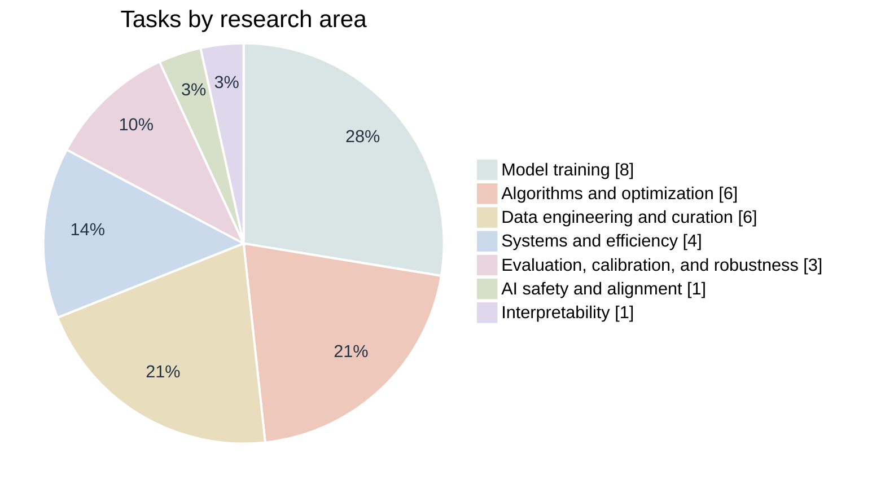

# AutoResearchExam

This repository contains the 29 tasks from [AutoResearchExam](https://benchmarks.bespokelabs.ai/autoresearchexam/).
Version 1.1 runs natively on [Harbor](https://github.com/harbor-framework/harbor) with any
agent harness. Leaderboard scores come from the official harness on version 1.0. See
[Run](#run) for both.

## Task areas



<details>
<summary>View tasks by area →</summary>

### Model training

#### Representation learning

- [Compact encoding for a column with many categories](./hicard-latent-encoder)
- [Compact item embeddings for recommendations](./sparse-elsa-item-embeddings-8nnz)
- [Short binary codes for image search](./mlh-coco-16bit-hash-head-map5000)

#### Reinforcement learning

- [Advantage estimation for policy training](./grpo-rl-halfcheetah-advantage-estimator)
- [Reliable control policy trainer](./reppo-reliable-onpolicy-control-trainer)

#### Predictive modeling

- [Predict valid actions for a game policy](./vas-maskless-deployment-feasibility)
- [Rank employee access requests from ID codes](./dctabeval-aeac-pooled-cat-statistics)

#### Model merging and distillation

- [Eight domain vision model merging](./ties-merging-clip-vitl14-eight-task-merge)

### Algorithms and optimization

#### Statistical methods

- [Estimate uncertainty in a streaming optimizer](./sketched-newton-cov-estimator)
- [Estimate individual treatment effects](./causalpfn-cate-pehe-ihdp-surfaceb)
- [Recover river flow links](./causalrivers-heldout-station-graph-auroc)

#### Constrained optimization

- [Dual market budgeted classification](./budgeted-covtype-dual-market-open)
- [MILP branching policy](./tgat-milp-branching-node-count)
- [Online chance constrained policy](./sopcc-online-chance-constrained-policy)

### Data engineering and curation

#### Imputation

- [Budgeted imputation](./budgeted-imputation-mcar50)
- [Sparse panel imputation](./act-tensor-sparse-panel-imputation-r2)

#### Data selection

- [Unlabeled pool pruning](./activeprune-al-unlabeled-pool-pruning)
- [Low discrepancy subset selection](./carps-star-discrepancy-subset-select)
- [Group robust coreset selection](./coreset-selection-group-robust-waterbirds)
- [Pretraining token budget selection](./less-is-more-pretrain-token-budget-selector)

### Systems and efficiency

#### Inference

- [CPU language model decoding](./cpu-llm-decode-throughput)
- [CPU decoder graph execution](./cpu-decoder-graph-executor)
- [Video diffusion transformer caching](./fastercache-budgeted-video-dit-cache-policy)

#### Compression

- [SVDQuant PixArt Sigma quantization](./svdquant-w4a4-psnr)

### Evaluation, calibration, and robustness

#### Metric estimation

- [Shortest valid confidence interval](./shortest-valid-ci-l2-ece)
- [Label efficient risk estimation](./label-efficient-risk-estimator)

#### Robustness

- [Adversarially robust CIFAR 10 training](./fast-adv-budgeted-pgd50-robust-cifar10)

### AI safety and alignment

- [Candidate token loss ranker](./fastergcg-candidate-token-rank-ccc)

### Interpretability

- [Sparse dictionary coding](./sae-sparse-dict-nmse-frontier)

</details>

## Run

Each run has a 24 hour research budget, and the agent should keep working until it ends.

### With the official harness

The leaderboard uses the
[v1.0 tasks](https://github.com/bespokelabsai/AutoResearchExam/tree/v1.0) with the official
[AutoResearchExam-Terminus](https://github.com/bespokelabsai/AutoResearchExam-Terminus)
harness. To reproduce leaderboard scores, follow the instructions in that repository.

### With your own harness

Install [Harbor](https://github.com/harbor-framework/harbor), start Docker, and set up your
model provider's credentials. Then run any agent harness on a task:

```bash
git clone https://github.com/bespokelabsai/AutoResearchExam.git
harbor run \
  --path AutoResearchExam/cpu-decoder-graph-executor \
  --agent <agent> --model <model> --env docker \
  --ak prompt_template_path=AutoResearchExam/are_protocol.md.j2
```

Use `--path AutoResearchExam` to run all tasks. `are_protocol.md.j2` adds the research protocol
after each task instruction: submit regularly, keep improving the solution, and keep going
until the run ends.

During the run, the agent can reach `api.openai.com` and `api.anthropic.com`. If your harness
uses another host, add `--allow-agent-host <host>`.

GPU tasks need an NVIDIA GPU and the NVIDIA Container Toolkit. Grading shares GPU 0 with the
agent by default. On a machine with a spare GPU, set `ARE_GRADER_GPU=1` to give grading its
own GPU.

## How autoresearch submissions and intermediate grading work

Each task runs the agent next to two grader containers.

- The agent submits with the `submit` tool of the `are` MCP server, or over HTTP at
  `http://grader:8000/submit`. The first grader scores the submission on the public
  validation split. The agent gets the score and grader output from the `result` tool.
- The second grader scores the same submission on the private test split. The agent cannot
  reach it and never sees these scores.
- Grading does not pause the agent. The agent keeps working while a submission is graded,
  but only one submission is graded at a time. A new submission is refused until the
  previous one has its validation score.
- When the agent stops, the final workspace is graded too, unless it matches the last
  submission.

In v1.0, grading paused the agent. Now the agent keeps working while a submission is
graded, so it has more working time. Because only one submission is graded at a time, an
agent cannot flood the grader.

Grading runs on the same machine as the agent and can compete with it for compute. A grader
uses as many cores as the task gives the agent, and the two graders never run at the same
time, so plan for about twice the cores each task requests.

## Scores

Each trial writes `verifier/reward.json`. Its `reward` is the private test score of the
submission with the best validation score. Its `auarc` uses each task's own score scale. To
put scores on the leaderboard scale, follow the
[scoring guide](https://github.com/bespokelabsai/AutoResearchExam-Terminus/blob/main/scripts/custom_harness.md)
to normalize scores and compute AUARC. Every submission's scores and times are in the
trial's `artifacts/var/lib/are/ledger.jsonl`.

## Citation

If you use AutoResearchExam in your research, please cite:

```bibtex
@misc{ramesh2026autoresearchexam,
  author = {Ramesh, Anirudha and
            Devic, Siddartha and
            Garg, Shivank and
            Parulekar, Advait and
            Mahnot, Drish and
            Pimpalgaonkar, Shreyas and
            Suresh, Vishnu and
            Dimakis, Alex and
            Sathiamoorthy, Maheswaran},
  title = {{AutoResearchExam}},
  year = {2026},
  month = sep,
  url = {https://benchmarks.bespokelabs.ai/autoresearchexam/},
  note = {Published September 9, 2026}
}
```
